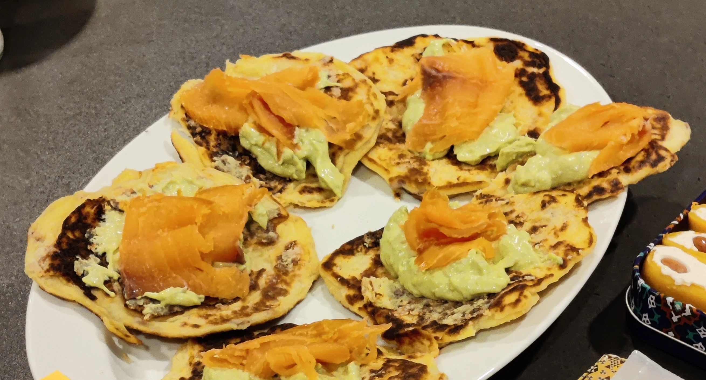

# Avokadokrem

[!ref target="blank" text="Originaloppskrift"](https://oppskrift.klikk.no/r%C3%B8kelaks-med-avocadokrem/1924/)

||| :timer_clock: Tid
25 min
||| :knife_fork_plate: Porsjoner
8
||| :cook: Vanskelighetsgrad
Enkel
|||

## Ingredienser

- 2 stk avokado
- 1/2 stk saften av sitron (eller 2x så mange lime)
- 100 g majones
- 1 dl rømme
- salt
- pepper

## Steg

1. Del avokado og ta ut fruktkjøttet med hjelp av en skje. Press over sitron/limesaft og
   mariner avokado i 10-15 min.
2. Mos avokadokjøttet med en gaffel og bland inn majones og rømme. Smak til med litt
   lime/sitronsaft, salt og pepper.

## Notater

!!!success Tilbehør
Om du ønsker tilbehør ved siden av retten kan
[bondelapper](/enkel-servering/bondelapper.md) med røkelaks være et godt alternativ.
!!!

